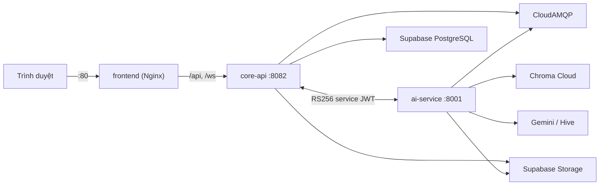

# Triển khai UniChat lên AWS EC2 (Docker Compose)

Phạm vi: `frontend` (React SPA + Nginx), `core-api` (Spring Boot), `ai-service` (FastAPI).
Mobile không deploy. PostgreSQL/Storage (Supabase), RabbitMQ (CloudAMQP), Chroma Cloud và
Gemini/Hive là dịch vụ cloud có sẵn — EC2 không chạy database.



## 1. Chọn instance

| Thành phần | RAM thực tế |
|---|---|
| ai-service (PyTorch CPU + `multilingual-e5-base`) | ~1,2–1,8 GB |
| core-api (JVM) | ~0,5–0,8 GB |
| nginx + hệ điều hành + Docker | ~0,4 GB |

- **t3.micro (1 GB) không chạy được** — ai-service sẽ bị OOM-kill khi nạp model.
- Tối thiểu: **4 GB RAM** (`t3.medium`, hoặc `c7i-flex.large` nếu tài khoản của bạn hiển thị nhãn
  *Free tier eligible* cho loại này). Khuyến nghị 8 GB (`t3.large` / `m7i-flex.large`).
- Ổ đĩa: **≥ 30 GB gp3** (8 GB mặc định không đủ: image ai-service ~2 GB, model ~1,1 GB, build cache).
- AMI: Amazon Linux 2023 (x86_64).
- Security Group inbound: `22` (chỉ IP của bạn), `80` (0.0.0.0/0), `443` nếu dùng HTTPS.
  Không mở 8001/8082.

## 2. Cài Docker trên Amazon Linux 2023

```bash
sudo dnf update -y
sudo dnf install -y docker git openssl
sudo systemctl enable --now docker
sudo usermod -aG docker ec2-user
newgrp docker

# AL2023 không có sẵn Compose v2 và Buildx -> cài plugin thủ công
sudo mkdir -p /usr/local/lib/docker/cli-plugins
sudo curl -fsSL https://github.com/docker/compose/releases/latest/download/docker-compose-linux-x86_64 \
  -o /usr/local/lib/docker/cli-plugins/docker-compose
BUILDX_VERSION=$(curl -fsSL https://api.github.com/repos/docker/buildx/releases/latest | grep -oP '"tag_name": "\K[^"]+')
sudo curl -fsSL "https://github.com/docker/buildx/releases/download/${BUILDX_VERSION}/buildx-${BUILDX_VERSION}.linux-amd64" \
  -o /usr/local/lib/docker/cli-plugins/docker-buildx
sudo chmod +x /usr/local/lib/docker/cli-plugins/*
docker compose version && docker buildx version
```

Nếu instance chỉ có 4 GB RAM, thêm swap để build không bị OOM:

```bash
sudo dd if=/dev/zero of=/swapfile bs=1M count=4096 && sudo chmod 600 /swapfile
sudo mkswap /swapfile && sudo swapon /swapfile
echo '/swapfile none swap sw 0 0' | sudo tee -a /etc/fstab
```

## 3. Lấy mã nguồn

> [!IMPORTANT]
> EC2 chỉ nhận được code **đã commit và push**. Các thay đổi đang nằm local (chưa commit) sẽ không có
> trên server, trong khi Flyway của core-api sẽ chạy migration trên Supabase dùng chung.

```bash
git clone <repo-url> unichat && cd unichat
```

## 4. Khóa và biến môi trường

```bash
./infra/scripts/generate-keys.sh        # core-service, ai-service, jwt (chown cho UID 10001)
cp .env.production.example .env && chmod 600 .env
openssl rand -hex 32                     # dán vào OTP_HMAC_SECRET
nano .env
```

Bắt buộc điền: `FRONTEND_ORIGIN`, `CORS_ALLOWED_ORIGINS` (đúng `http://<IP-public>`), `POSTGRES_*`,
`RABBITMQ_URL`, `CHROMA_CLOUD_*`, `SUPABASE_*`, `OTP_HMAC_SECRET`, `GEMINI_API_KEY`.
Thiếu biến bắt buộc thì `docker compose` dừng ngay và báo tên biến.

> [!TIP]
> Nên cấp Elastic IP cho instance; nếu IP public đổi sau khi stop/start, phải sửa `FRONTEND_ORIGIN`
> và `CORS_ALLOWED_ORIGINS` rồi `docker compose up -d`.

## 5. Khởi chạy

```bash
docker compose up -d --build
docker compose ps            # chờ cả 3 service "healthy" (lần đầu 3–10 phút)
docker compose logs -f core-api ai-service
```

Truy cập `http://<EC2-PUBLIC-IP>`. Câu hỏi đầu tiên sẽ chậm vì ai-service tải model embedding
(~1,1 GB, lưu trong volume `unichat-hf-cache`, chỉ tải một lần).

### Phương án nhẹ hơn: build ở máy khác, EC2 chỉ pull

```bash
# Máy có Docker (local/CI)
export IMAGE_REGISTRY=ghcr.io/<owner>/unichat IMAGE_TAG=$(git rev-parse --short HEAD)
docker compose build && docker compose push
# EC2: thêm IMAGE_REGISTRY/IMAGE_TAG vào .env rồi
docker compose pull && docker compose up -d --no-build
```

## 6. HTTP và HTTPS

| Chế độ | `UNICHAT_SECURITY_PROFILE` | Ghi chú |
|---|---|---|
| Truy cập bằng IP, HTTP | `local` | Cookie không Secure, CSRF tắt (ADR-020). Chỉ dùng demo. |
| Có domain + HTTPS | `production` | Bắt buộc HTTPS; nếu đặt `production` mà chạy HTTP, đăng nhập sẽ hỏng vì trình duyệt bỏ cookie Secure. |

HTTPS: đặt ALB + ACM phía trước (Nginx đã chuyển tiếp `X-Forwarded-Proto` và core-api bật
`SERVER_FORWARD_HEADERS_STRATEGY=framework`), sau đó đổi `FRONTEND_ORIGIN`/`CORS_ALLOWED_ORIGINS`
sang `https://...` và profile sang `production`.

## 7. Vận hành

```bash
git pull && docker compose up -d --build     # cập nhật
docker compose restart core-api              # khởi động lại một service
ssh -L 8082:127.0.0.1:8082 ec2-user@<IP>      # xem /actuator/health từ máy cá nhân
docker system prune -f                        # dọn image cũ khi đầy đĩa
```

## 8. Sự cố thường gặp

| Triệu chứng | Nguyên nhân |
|---|---|
| `ai-service` restart liên tục, `Exited (137)` | Thiếu RAM — tăng instance hoặc `AI_SERVICE_MEM_LIMIT`. |
| core-api: `RS256 public and private keys must both be configured` / `SERVICE_KEY_READ_FAILED` | Chưa chạy `generate-keys.sh` hoặc thư mục `.service-keys` chưa chown 10001. |
| core-api: `OTP_HMAC_SECRET must contain at least 32 characters` | Thiếu secret trong `.env`. |
| Đăng nhập báo lỗi Origin / CORS | `FRONTEND_ORIGIN` và `CORS_ALLOWED_ORIGINS` không khớp chính xác URL trên trình duyệt. |
| Hỏi đáp lỗi `CORE_POLICY_UNCONFIGURED` | ai-service bị đặt `APP_ENV=production` khi gọi core-api qua HTTP nội bộ — giữ `AI_APP_ENV=staging`. |
