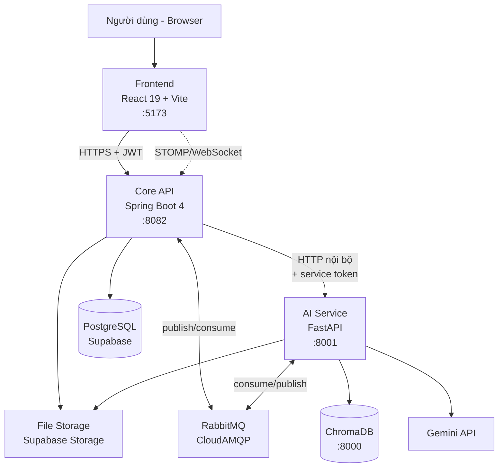
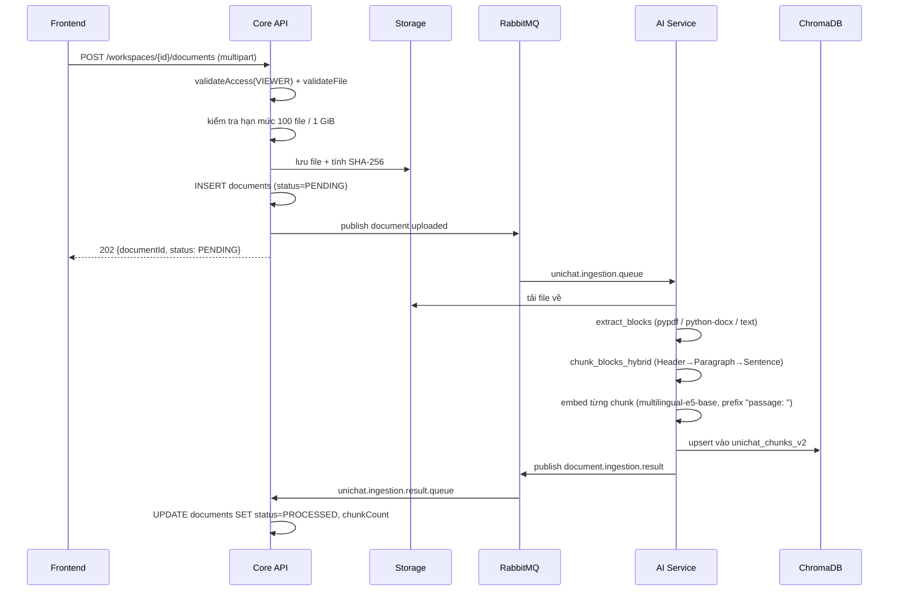
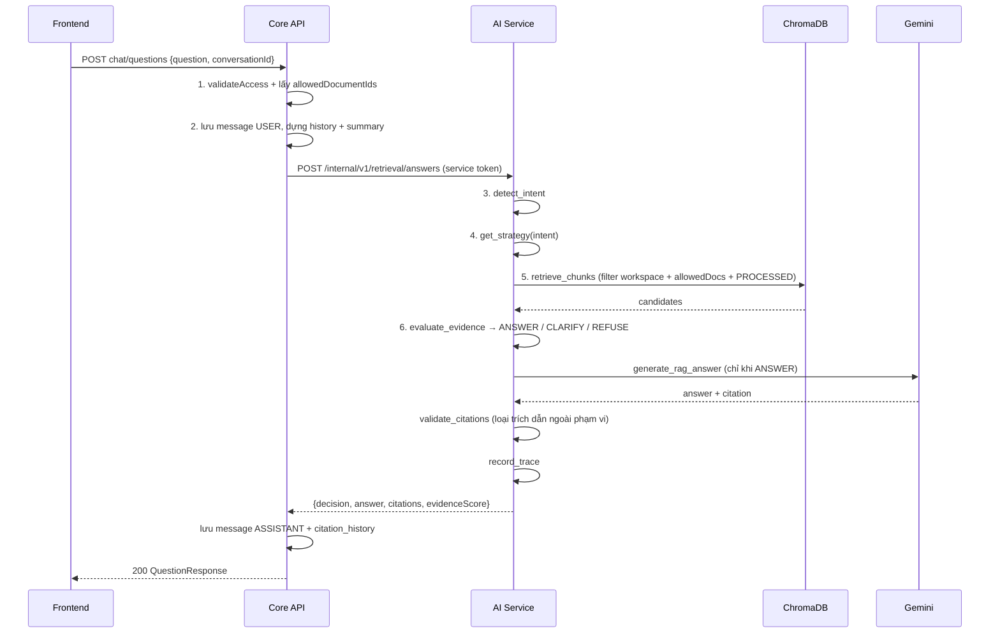

# UniChat — Tổ chức thư mục và cơ chế hoạt động

Tài liệu này giải thích dự án ở mức "đọc một lần là hiểu đi đâu tìm gì": hệ thống gồm những process nào, mỗi thư mục chứa gì, và một request đi qua những đâu.

Đây là tài liệu **giải thích**, không phải nguồn chuẩn. Khi có xung đột, nguồn chuẩn là `docs/specifications/` (architecture-decision, file-plan, api-contracts, data-model, adaptive-retrieval-spec, test-plan).

---

## 1. Bức tranh toàn cảnh

UniChat là nền tảng tri thức AI cho giáo dục đại học. Chức năng P0 là **Adaptive Knowledge Retrieval & Reasoning**: người dùng upload tài liệu (PDF/DOCX/TXT) vào Workspace có phân quyền, rồi đặt câu hỏi và nhận câu trả lời **kèm trích dẫn** chỉ từ những tài liệu họ được phép đọc.

Hệ thống có **3 process do mình viết** và **4 hạ tầng bên ngoài**:



**Quy tắc kiến trúc quan trọng nhất:** chỉ Frontend và Core API được expose ra ngoài. AI Service, PostgreSQL, ChromaDB, RabbitMQ nằm trên mạng private. Browser **không bao giờ** gọi AI Service trực tiếp.

| Thành phần | Công nghệ | Port | Sở hữu cái gì |
|---|---|---|---|
| `frontend` | React 19.2, TypeScript, Vite, TanStack Query, React Router 7 | 5173 | Giao diện. Không phải điểm kiểm soát bảo mật |
| `core-api` | Spring Boot 4.1.0, Java, Spring Security, JPA, Flyway | 8082 | **Authentication + authorization**, nghiệp vụ, PostgreSQL, file storage |
| `ai-service` | FastAPI, Python 3.13, sentence-transformers, ChromaDB client | 8001 | Bóc tách văn bản, chunking, embedding, retrieval, sinh câu trả lời |
| ChromaDB | Vector database | 8000 | Vector của chunk tài liệu |
| PostgreSQL | Supabase (pooler :6543) | — | Toàn bộ dữ liệu nghiệp vụ |
| RabbitMQ | CloudAMQP (amqps :5671) | — | Hàng đợi ingestion bất đồng bộ |
| Gemini | Google GenAI SDK | — | LLM sinh câu trả lời |

> **Lưu ý về Java:** `README.md` ghi Java 21 LTS, còn `core-api/pom.xml:21` đặt `<java.version>17</java.version>`. Hai chỗ này đang lệch nhau — build thực tế theo pom.

---

## 2. Tổ chức thư mục

### 2.1 Cấp cao nhất

```
unichat/
├── frontend/          # React SPA
├── core-api/          # Spring Boot — ranh giới bảo mật
├── ai-service/        # FastAPI private
├── automation-tests/  # Playwright E2E (8 bộ spec)
├── infra/             # compose.yaml cho Postgres + Chroma local
├── docs/              # specifications, ADR, runbooks, luận văn
├── .pipeline/         # decisions-log.md — nhật ký quyết định
├── .github/           # CI workflow + script audit dependency
├── dev.ps1            # chạy cả stack trong Windows Terminal
├── AGENTS.md          # chuẩn kỹ thuật bắt buộc
└── .env               # secret local (không commit)
```

`docs/` chia theo mục đích rõ ràng:

| Thư mục | Nội dung |
|---|---|
| `docs/specifications/` | **Nguồn chuẩn**: data-model, api-contracts, permission-matrix, threat-model, test-plan, sơ đồ `.drawio` |
| `docs/adr/` | Architecture Decision Record tách riêng |
| `docs/runbooks/` | Hướng dẫn vận hành: local-development, frontend-coding-standards |
| `docs/security/` | Nợ bảo mật đang theo dõi |
| `docs/thesis/` | 7 nhóm tài liệu khóa luận, giữ nguyên tên nhóm |

### 2.2 `core-api` — tổ chức theo feature, 3 lớp

Đường dẫn gốc: `core-api/src/main/java/com/unichat/core/`

Mỗi feature là **một thư mục độc lập**, bên trong chia đúng 3 lớp:

```
<feature>/
├── api/        # Controller + record Request/Response (ranh giới HTTP)
├── service/    # Nghiệp vụ, @Transactional, quyết định quyền
└── domain/     # @Entity, Repository, enum, domain event
```

Các feature hiện có:

| Feature | Vai trò | File đáng đọc trước |
|---|---|---|
| `auth` | Đăng ký, đăng nhập, refresh token, quên mật khẩu | `service/TokenService.java`, `service/AuthService.java` |
| `user` | Profile, avatar, đổi mật khẩu, trạng thái | `domain/User.java` |
| `workspace` | Workspace + thành viên + vai trò | `service/WorkspaceService.java`, `domain/WorkspaceRole.java` |
| `document` | Upload, duyệt đóng góp, download, xóa, hàng đợi ingestion | `service/DocumentService.java`, `messaging/` |
| `chat` | Hỏi đáp RAG, conversation, citation, studio note | `service/ChatService.java`, `service/SseChatService.java` |
| `communitychat` | Feed, bài viết, thảo luận, reaction, mention, thông báo, tìm kiếm | `service/DiscussionService.java`, `service/AiReplyService.java` |
| `workchat` | Nhắn tin 1-1, chat nhóm, tệp đính kèm, WebSocket | `service/DirectMessageService.java`, `ws/` |
| `admin` | Quản trị người dùng | `api/AdminUserController.java` |
| `common` | Lỗi typed + RFC 7807, filter request ID | `error/GlobalErrorHandler.java` |
| `shared` | Security config, JWT key, idempotency, UUIDv7 | `config/SecurityConfiguration.java` |

`workchat` có thêm lớp thứ tư là `ws/` (WebSocket config, STOMP interceptor, broadcaster, presence) vì realtime không thuộc lớp HTTP.

Migration SQL nằm ở `core-api/src/main/resources/db/migration/`, đánh số `V1` → `V31`.

### 2.3 `ai-service` — tổ chức theo vai trò kỹ thuật

```
ai-service/app/
├── main.py              # FastAPI factory + lifespan khởi động consumer
├── api/v1/              # retrieval.py, eval.py, health.py
├── core/
│   ├── settings.py      # Pydantic Settings, chỉ đọc từ env
│   ├── security.py      # verify_service_jwt cho route nội bộ
│   ├── logging.py       # structlog + stdlib
│   └── rag/             # ⭐ trái tim của P0
├── services/            # I/O: extract, chunk, embed, RabbitMQ, storage
├── evaluation/          # benchmark, metrics, report
├── config/              # adaptive-retrieval-v1.yml (rule intent)
└── tests/               # 23 file pytest
```

`core/rag/` là nơi chứa thuật toán, tách thành các bước có thể test riêng:

| File | Nhiệm vụ |
|---|---|
| `intent_detector.py` | Phân loại câu hỏi thành FACT / DEFINITION / COMPARISON / SUMMARY / REASONING / CLARIFY / OUT_OF_SCOPE bằng rule YAML |
| `strategy_selector.py` | Mỗi intent → một `RetrievalStrategy` (top_k, ngưỡng similarity, số nguồn tối thiểu) |
| `retrieval_engine.py` | Query ChromaDB có filter quyền, đổi cosine distance thành similarity |
| `evidence_gate.py` | Tính `evidence_score` và quyết định ANSWER / CLARIFY / REFUSE |
| `prompt_builder.py` | Dựng system prompt + context có đánh số nguồn |
| `llm_provider.py` | Gọi Gemini, xoay vòng nhiều API key và nhiều model dự phòng |
| `citation_validator.py` | Loại bỏ trích dẫn trỏ ra ngoài `allowedDocumentIds` |
| `retrieval_trace.py` | Ghi trace mỗi lần retrieval để đánh giá |
| `conversation_memory.py` | Nén hội thoại dài thành summary |
| `stream_provider.py` | Phiên bản streaming SSE của sinh câu trả lời |

### 2.4 `frontend` — feature-based, co-locate tất cả

```
frontend/src/
├── main.tsx, App.tsx
├── app/
│   ├── app-providers.tsx   # ErrorBoundary > QueryClient > AuthProvider
│   ├── app-router.tsx      # toàn bộ route, lazy-load từng page
│   ├── app-shell.tsx       # layout có nav toàn cục
│   └── workspace-shell.tsx # layout trong phạm vi một workspace
├── components/             # dùng chung thật sự: avatar, nav, footer, icon
├── lib/                    # api-client, query-client, format-bytes, format-time
└── features/<tên>/
    ├── <tên>-api.ts        # gọi HTTP, định nghĩa type của feature
    ├── <tên>-page.tsx      # page cấp route
    ├── <tên>-page.css
    ├── components/         # component chỉ feature này dùng
    └── *.test.tsx          # test nằm cạnh file nó kiểm tra
```

13 feature: `auth`, `landing`, `workspaces`, `members`, `documents`, `chat`, `history`, `community`, `work-chat`, `profile`, `account`, `settings`, `admin`, `evaluation`, `errors`.

Nguyên tắc: **một feature không import từ feature khác**. Thứ gì hai feature đều cần thì chuyển lên `lib/` hoặc `components/`.

### 2.5 Quy ước đặt tên và giới hạn (theo `AGENTS.md`)

| Quy ước | Giá trị |
|---|---|
| File và thư mục | `kebab-case` |
| Type và component | `PascalCase` |
| Biến và hàm | `camelCase` |
| Hàm logic thuần | ≤ 30 dòng |
| Render React | ≤ 60 dòng JSX, tuyệt đối không quá 100 |
| File | < 300 dòng (config/schema/UI phức tạp được tới 500) |
| Lồng ghép thư mục | tối đa 4 cấp dưới mỗi source root |
| Thứ tự import | external → internal → relative → types |
| Encoding | UTF-8 không BOM, giữ đủ dấu tiếng Việt |

---

## 3. Bốn cơ chế nền tảng

### 3.1 Xác thực

Hai loại token, cố ý khác nhau:

| | Access token | Refresh token |
|---|---|---|
| Dạng | JWT RS256 | Chuỗi opaque 32 byte ngẫu nhiên |
| Sống | 15 phút (`application.yml`) | 7 ngày |
| Lưu ở server | Không lưu | Lưu **SHA-256 hash**, không lưu bản thô |
| Lưu ở client | Trong memory (không localStorage) | — |
| Xoay vòng | — | Mỗi lần dùng sinh token mới |

Cơ chế chống trộm nằm ở `auth/service/TokenService.java:90` (`rotateRefreshToken`): mỗi token có `familyId`. Khi một token **đã dùng rồi** lại được gửi lên lần nữa, hệ thống hiểu là có người đang dùng bản copy, nên **thu hồi toàn bộ family** chứ không chỉ token đó.

Mật khẩu băm bằng Argon2id, còn chấp nhận hash BCrypt cũ qua `DelegatingPasswordEncoder` (`shared/config/SecurityConfiguration.java:35`).

`SecurityConfiguration.java:77` định nghĩa ranh giới: `/api/v1/health`, `/api/v1/auth/**` và handshake WebSocket là public; `/api/v1/admin/**` cần `SCOPE_ADMIN`; mọi thứ còn lại cần bearer token hợp lệ. Session `STATELESS`.

### 3.2 Phân quyền — Core API là **nguồn quyền duy nhất**

Đây là bất biến xuyên suốt dự án:

> Core API tính quyền. AI Service nhận danh sách document ID đã được cho phép và **không bao giờ** trở thành nơi kiểm tra quyền thứ hai.

Cụ thể trong `chat/service/ChatService.java`:

1. `validateAccess(userId, workspaceId)` — kiểm tra workspace tồn tại và người gọi là thành viên `ACTIVE`.
2. `documentRepository.findAllowedDocumentIdsForWorkspaces(...)` — lấy đúng những document ID được đọc.
3. Gửi danh sách đó sang AI Service trong field `allowedDocumentIds`.
4. AI Service dùng nó làm **filter cứng** khi query ChromaDB (`retrieval_engine.py:85`), rồi lại dùng lần nữa để loại trích dẫn lệch (`citation_validator.py:37`).

Ba hệ quả thực tế:
- Tài liệu đang chờ duyệt (`PENDING_APPROVAL`) **không được gửi đi ingestion**, nên không vào ChromaDB và không vào danh sách quyền (`DocumentService.java:222`).
- Query ChromaDB luôn kèm `document_status = PROCESSED`, nên tài liệu đang xóa không lọt ra.
- Tệp gửi trong Work Chat **không có `document_id`** — chúng không vào kho tài liệu, AI không đọc và không trích dẫn được (ADR-022).

Ma trận quyền đầy đủ: `docs/specifications/permission-matrix.md`. Tóm lại ba vai trò Workspace là OWNER / EDITOR / VIEWER, với ba chế độ PRIVATE / SHARED / PUBLIC.

### 3.3 Lỗi — RFC 7807 ở mọi nơi

`common/web/RequestIdFilter.java` chạy đầu tiên trong filter chain: đọc header `X-Request-Id` (chỉ nhận `[A-Za-z0-9._-]{1,64}`, nếu không hợp lệ thì tự sinh UUID), đặt vào MDC để log có ngữ cảnh, và trả lại trong response header.

`common/error/GlobalErrorHandler.java` biến mọi lỗi thành `application/problem+json`. Các lỗi typed: `ValidationError`, `UnauthenticatedError`, `AuthorizationError`, `NotFoundError`, `ConflictError`, `FileRejectedError`, `InternalError`.

Phía frontend, `lib/api-client.ts:140` (`handleResponse`) đọc `detail` / `title` / `fieldErrors` để hiện thông báo thân thiện; `features/errors/error-boundary.tsx` chặn lỗi render.

Nguyên tắc: **client nhận thông báo thân thiện, server giữ chi tiết**. `StompAuthChannelInterceptor.java:76` là ví dụ rõ nhất — lý do token bị từ chối chỉ ghi vào log, không trả về, vì nói cho người gọi biết "sai ở đâu" là giúp họ forge token tốt hơn.

### 3.4 Logging

Core API dùng SLF4J + `logback-spring.xml` (JSON qua logstash encoder). AI Service dùng `structlog` + stdlib (`core/logging.py`).

Luôn redact: token, prompt, nội dung chunk, nội dung tài liệu. `rabbitmq_consumer.py:115` có `_redact_url` để URL AMQP in ra log không mang mật khẩu.

---

## 4. Các luồng hoạt động

### 4.1 Đăng nhập và tự làm mới token

```
Browser          Core API
  │ POST /api/v1/auth/login {email, password}
  ├────────────────►  AuthService: tìm user, verify Argon2/BCrypt
  │                   TokenService: tạo access JWT (15') + refresh (7 ngày)
  │◄──────────────── 200 {accessToken, user}  + refresh trong HttpOnly cookie
  │
  │  ... 15 phút sau, access token hết hạn ...
  │
  │ GET /api/v1/workspaces  (token cũ)
  ├────────────────►  401
  │  api-client tự động:
  │ POST /api/v1/auth/refresh
  ├────────────────►  rotateRefreshToken: phát hiện reuse → thu hồi family
  │◄──────────────── 200 {accessToken mới}
  │ GET /api/v1/workspaces  (retry với token mới)
  ├────────────────►  200
```

Phần tự refresh nằm trong `lib/api-client.ts:104`. Access token giữ trong memory, không localStorage; `registerTokenAccessor` cho phép api-client đọc/ghi token mà không phụ thuộc React context (ADR-005).

### 4.2 Upload tài liệu → ingestion (bất đồng bộ)

Đây là luồng duy nhất đi qua RabbitMQ, vì bóc tách + embedding mất hàng chục giây.



Chi tiết đáng biết:

- **Hạn mức** kiểm tra trước khi ghi: tối đa 100 tài liệu và 1 GiB mỗi Workspace (`DocumentService.java:178`).
- **Đóng góp của VIEWER** vào trạng thái `PENDING_APPROVAL` và **không** được publish lên queue. Phải có OWNER/EDITOR duyệt mới đi tiếp.
- **Nếu publish thất bại**, exception chỉ được log, document ở lại `PENDING` để retry sau — upload không bị fail theo (`DocumentIngestionProducer.java:35`).
- **Chunking 3 tầng** (`services/chunker.py`): cắt theo heading, rồi theo đoạn, rồi theo câu, với 2 câu overlap; mỗi chunk 200–3000 ký tự và có `content_hash` để phát hiện tài liệu đã đổi.
- **Locator** cho từng chunk để trích dẫn chỉ được chỗ: PDF → số trang, DOCX → chỉ số block/đoạn, TXT → dòng bắt đầu/kết thúc.

Topology RabbitMQ (`core/config/RabbitMqConfig.java`):

| Exchange | Routing key | Queue | Ai đọc |
|---|---|---|---|
| `unichat.ingestion.exchange` | `document.uploaded` | `unichat.ingestion.queue` | AI Service |
| `unichat.ingestion.exchange` | `document.ingestion.result` | `unichat.ingestion.result.queue` | Core API |
| `unichat.dlq.exchange` | `document.dlq` | `unichat.dlq.queue` | — (thủ công) |

### 4.3 Hỏi đáp RAG — pipeline 6 bước

Đây là chức năng P0. Entry point: `POST /api/v1/workspaces/{id}/chat/questions`.



**Bước 3 — nhận dạng ý định.** `intent_detector.py` bỏ dấu tiếng Việt rồi khớp rule từ `app/config/adaptive-retrieval-v1.yml`. File YAML được hash SHA-256 và cache trong memory, nên đổi rule là cache tự invalidate — và `config_hash` đi vào trace để biết câu trả lời sinh ra dưới bộ rule nào.

**Bước 4 — chiến lược theo ý định.** Đây chính là chữ "Adaptive" (`strategy_selector.py`):

| Intent | top_k | Ngưỡng similarity | Chunk tối đa | Nguồn tối thiểu | Ngưỡng evidence |
|---|---:|---:|---:|---:|---:|
| FACT | 5 | 0.70 | 4 | 1 | 0.72 |
| DEFINITION | 4 | 0.72 | 3 | 1 | 0.74 |
| COMPARISON | 10 | 0.64 | 6 | **2** | 0.68 |
| SUMMARY | 12 | 0.60 | 8 | **3** | 0.66 |
| REASONING | 12 | 0.62 | 8 | 2 | 0.68 |
| OUT_OF_SCOPE | 0 | — | 0 | 0 | — |

Logic phía sau: câu hỏi so sánh *phải* có từ 2 nguồn trở lên mới trả lời được, còn câu hỏi tra cứu một dữ kiện thì cần độ khớp cao nhưng chỉ cần một nguồn.

**Bước 6 — Evidence Gate.** `evidence_gate.py` tính:

```
evidence_score = 0.50 × top_similarity
               + 0.30 × mean(top-3 similarity)
               + 0.20 × coverage_score
```

Nếu điểm dưới ngưỡng của intent, hệ thống **từ chối trả lời** thay vì đoán. Có một điều chỉnh thích ứng đáng chú ý: khi Workspace chỉ có 1–2 tài liệu, `min_source_groups` được hạ xuống theo số tài liệu thật, để một workspace nhỏ không bị từ chối oan.

**Các mã từ chối** mà frontend cần phân biệt:

| refusalCode | Nghĩa |
|---|---|
| `NO_ALLOWED_DOCUMENTS` | Người dùng không có tài liệu nào được phép trong Workspace |
| `CLARIFY_REQUIRED` | Câu hỏi thiếu ngữ cảnh, cần hỏi lại |
| `EVIDENCE_INSUFFICIENT` | Tài liệu không đủ bằng chứng |
| `CITATION_VALIDATION_FAILED` | LLM trích dẫn ra ngoài phạm vi được cấp quyền |
| `PROVIDER_UNAVAILABLE` | Không gọi được AI Service (fallback của `ChatService.callAiService`) |

**Độ bền của tầng LLM.** `llm_provider.py` xoay vòng nhiều `GEMINI_API_KEY` × nhiều model dự phòng (`gemini-3.5-flash` → `gemini-2.5-flash` → `gemini-flash-latest` → `gemini-flash-lite-latest`), nên hết quota một key không làm sập chức năng.

**Bộ nhớ hội thoại.** Hội thoại dài được nén thành `summary` lưu trên bảng `conversations`, cập nhật bằng optimistic locking trên `summaryVersion` (ADR-021) để hai request song song không ghi đè nhau.

**Trace.** Mỗi lần retrieval ghi một `RetrievalTrace`: intent, rule_id, confidence, config_hash, số tài liệu được phép, chunk nào được lấy, evidence score, decision, provider, latency. Đây là dữ liệu cho `app/evaluation/` chạy benchmark và cho trang Evaluation trên UI.

### 4.4 Streaming SSE

Bản đồng bộ ở trên trả về một lần. Ngoài ra có `POST /api/v1/workspaces/{id}/chat/questions/stream` (`chat/api/ChatController.java:80`) trả `text/event-stream` qua `SseEmitter`, phía AI Service là `stream_provider.py`. Cùng pipeline, chỉ khác cách đẩy token ra.

### 4.5 Community — feed, thảo luận và `@AI`

`communitychat` là feature lớn nhất (57 file). Mô hình gần giống Reddit: bài viết trong Workspace, có vote/score, reaction, bình luận lồng nhau, bookmark, mention, thông báo, tìm kiếm hợp nhất, và tệp đính kèm.

Điểm thú vị về kiến trúc: **mention `@AI` trong thảo luận**. Khi người dùng tag AI, `MentionResolver` phát một `AiMentionEvent`; `AiReplyService` xử lý ở **background thread**, gọi `AiRetrievalClient` (`service/AiRetrievalClient.java`) rồi lưu reply kèm `ReplyCitation`.

Hai chi tiết quan trọng trong `AiRetrievalClient`:
- Timeout rõ ràng: connect 5s, read 90s. Không có timeout thì một lần LLM treo sẽ giữ thread mãi.
- Khi lỗi thì trả **map rỗng** chứ không ném exception, vì nó chạy trên background thread — không còn ai để propagate lên (`AiRetrievalClient.java:87`).

Tương tự, "tóm tắt tệp đính kèm này" được làm bằng cách gọi AI Service với `allowedDocumentIds` **chỉ chứa đúng một document** — chính việc thu hẹp danh sách quyền là thứ buộc câu trả lời chỉ dựa trên tệp đó.

### 4.6 Work Chat — nhắn tin realtime

`workchat` xử lý nhắn tin 1-1 và chat nhóm, có gửi tệp, qua STOMP trên WebSocket.

**Kết nối và xác thực.** Handshake HTTP của WebSocket không mang được header `Authorization` từ browser, nên `SecurityConfiguration.java:88` để `/ws/work-chat/**` ở chế độ `permitAll`, và danh tính được xác lập ở **frame STOMP CONNECT** bởi `StompAuthChannelInterceptor`. Một CONNECT không có token hợp lệ bị từ chối, để lại một kết nối không subscribe và không gửi được gì.

**Tại sao không dùng topic theo conversation.** `StompAuthChannelInterceptor` xác thực lúc CONNECT nhưng **không kiểm tra SUBSCRIBE**. Nếu dùng `/topic/conversation/{id}` thì bất kỳ ai đã đăng nhập cũng subscribe được vào id đó. Vì vậy `WorkChatBroadcaster` fan-out tới **user destination từng người** (`/user/queue/messages`) — Spring định tuyến theo tên principal (là user id), nên không ai gọi được queue của người khác.

**Chờ commit mới đẩy.** Broadcaster dùng `@TransactionalEventListener(phase = AFTER_COMMIT)`. Nếu đẩy trước commit mà transaction rollback, người nhận sẽ thấy một tin nhắn không tồn tại và không có event nào sau đó xóa nó đi.

Hai destination:

| Destination | Khi nào | Payload |
|---|---|---|
| `/user/queue/messages` | Có tin nhắn mới | `MessageResponse` |
| `/user/queue/conversations` | Danh sách hội thoại đổi mà không có tin nhắn (được thêm vào nhóm, bị xóa khỏi nhóm, nhóm đổi tên) | conversation id |

**Mô hình dữ liệu.** Bảng tên `direct_conversations` nhưng chứa **cả hai loại** (`kind` = DIRECT/GROUP) — tên bảng là di sản lịch sử, ghi trong ADR-023. Mọi hội thoại, kể cả 1-1, đều có hàng trong `conversation_participants`, nên code chỉ có một đường đi thay vì hai nhánh.

Trạng thái đọc là **mốc nước** (`last_read_at` trên từng participant), không phải cờ trên từng tin nhắn. Đọc 50 tin nhắn là một lần UPDATE, không phải 50 lần.

**Tệp đính kèm.** Tối đa 5 tệp / tin nhắn, tổng 20 MiB, allowlist ảnh + PDF/DOCX/TXT (loại SVG và HTML vì chúng chạy script được). Quyết định quan trọng: `chat_attachments` **không có** `document_id`. Tệp gửi trong chat không vào kho tài liệu, không được ingest, AI không đọc và không trích dẫn (ADR-022) — đúng như phạm vi đã chọn: chỉ để xem và tải.

Endpoint tải nội dung tệp đặt `X-Content-Type-Options: nosniff`, chỉ cho hiển thị inline với ảnh, và kiểm tra cả ba liên kết (người gọi là participant → tin nhắn thuộc hội thoại → attachment thuộc tin nhắn) trước khi trả bytes.

Giới hạn nhóm: tối đa 50 người, và **mọi người được thêm vào nhóm đều phải thỏa `ContactDirectory.canMessage`** — không có luật này thì tạo nhóm trở thành cách lách quy tắc "người lạ không nhắn tin được cho bạn".

---

## 5. Tầng dữ liệu

### 5.1 PostgreSQL + Flyway

Hibernate chạy với `ddl-auto: validate` — schema **chỉ** đổi qua migration, không bao giờ do JPA tự sinh. Nếu entity lệch schema, ứng dụng không khởi động.

Cấu hình Flyway (`application.yml:14`) và lý do từng tùy chọn:

| Tùy chọn | Giá trị | Vì sao |
|---|---|---|
| `validate-on-migrate` | `true` | Để số version đã bị chiếm trên database chung **fail to lớn**, thay vì migration của nhánh này bị bỏ qua trong im lặng |
| `out-of-order` | `true` | Cho phép merge hai nhánh có số migration xen kẽ |
| `ignore-migration-patterns` | `*:missing,*:ignored,*:future` | Tha cho migration đã apply từ nhánh khác mà cây code này không có. Ba lớp này khác nhau: `missing` = đã apply, số thấp hơn, không có file; `ignored` = có file nhưng chưa apply và không phải số cao nhất; `future` = đã apply với số **cao hơn mọi file ở đây** |
| `baseline-on-migrate` | `true` | Cho phép chạy trên database đã có dữ liệu |

**Bài học đã trả giá (V29).** Database dev dùng chung bị apply một migration `V29 admin user seed` từ một working copy chưa commit trên máy khác. Khi nhánh này tạo file `V29__chat_attachments.sql`, Flyway thấy checksum không khớp và chặn khởi động.

Cách xử lý đúng: **đổi số** thành `V30`/`V31` (cao hơn mọi thứ đã apply) và làm cả hai file **idempotent**. Cách xử lý sai là `flyway repair` — nó sẽ dập checksum của nhánh này lên một hàng mô tả migration của người khác, để lại history nói dối và SQL của mình thì chưa chạy.

**Lần thứ hai (V32, V33 — 2026-10-10).** Cùng một nguyên nhân nhưng biểu hiện ngược: database có version 32 (`add direct messages read at`) và 33 (`schema catchup v30 v31`), cả hai **không có trong bất kỳ ref git nào**. Vì chúng cao hơn số lớn nhất ở đây (31), Flyway xếp chúng vào lớp `future` — không phải `missing` — và pattern cũ không bao gồm lớp đó, nên `validate` chặn khởi động với "Detected applied migration not resolved locally".

Cách xử lý: thêm `*:future` vào `ignore-migration-patterns`. Đây là nới đúng phạm vi, không phải nới bừa — `future` là những số mà cây code này **không hề đặt tên**, nên không có gì để xung đột; còn đụng vào một số mà cây code này *có* khai báo thì vẫn fail dưới dạng checksum mismatch, đúng như V29 đã chứng minh. `flyway repair` lần này còn tệ hơn: nó sẽ **xóa** hai hàng mô tả migration đã chạy thật.

Lưu ý khi merge: V32 **dựng lại** `direct_messages.read_at`, cột mà V31 đã bỏ khi chuyển trạng thái đọc sang mốc nước trên từng participant (ADR-023). Nghĩa là còn một nhánh đang giữ thiết kế cũ. Cột đó nullable nên hiện tại vô hại với code ở đây, nhưng khi merge phải chọn một trong hai thiết kế.

Quy tắc rút ra: **đừng apply migration từ working copy chưa commit lên database dùng chung.** Đã xảy ra hai lần; cách sửa bền là mỗi người một database, hoặc thống nhất chỉ apply sau khi đã commit.

Nhóm bảng chính (chi tiết đầy đủ ở `docs/specifications/data-model.md`):

| Nhóm | Bảng |
|---|---|
| Danh tính | `users`, `refresh_tokens`, `password_reset_otps` |
| Workspace | `workspaces`, `workspace_members` |
| Tài liệu | `documents`, `document_reviews` |
| Hỏi đáp | `conversations`, `messages`, `citation_history`, `studio_notes` |
| Quan sát | `retrieval_traces`, `retrieval_trace_items`, `audit_events` |
| Đánh giá | `evaluation_cases`, `evaluation_runs`, `evaluation_results` |
| Community | `discussions`, `discussion_replies`, `reactions`, `bookmarks`, `notifications`, `post_attachments`, `post_reads` |
| Work Chat | `direct_conversations`, `conversation_participants`, `direct_messages`, `chat_attachments` |
| Hạ tầng | `idempotency_records`, `rate_limit_buckets` |

Row Level Security được bật theo kiểu **defense in depth** (`V6__enable_rls_defense_in_depth.sql`, và mỗi migration mới tự thêm policy `deny_all` cho bảng của nó): nếu có ai nối thẳng vào database bằng role ứng dụng thì vẫn không đọc được dữ liệu ngoài đường đi của service.

> Cây code hiện tại nhảy từ `V22` sang `V24` — bản `V23__enable_rls_defense_in_depth_v2.sql` nằm trên `origin` mà nhánh local chưa có. Cần merge trước khi dựng database mới.

> **Cảnh báo khi debug qua Supabase pooler (:6543):** đừng bao giờ dùng `SET` ở mức session, kể cả `SET default_transaction_read_only = on` với ý tốt. Pooler trả connection về pool mà vẫn giữ setting đó, và nó sẽ dính vào request tiếp theo của người khác. Muốn chỉ đọc thì mở `BEGIN READ ONLY` ở mức transaction.

### 5.2 ChromaDB

Collection `unichat_chunks_v2` (fallback `unichat_chunks_v1`), cosine distance, 768 chiều. Embedding model `intfloat/multilingual-e5-base` — model này đòi prefix: chunk lưu với `passage: `, câu hỏi query với `query: `.

Mỗi record mang metadata `workspace_id`, `document_id`, `document_status`, `chunk_index`, `locator_type`, `locator_value`, `content_hash`. Query **luôn** filter cả ba điều kiện workspace + allowedDocumentIds + status.

Client chọn chế độ linh hoạt (`vector_store.py:28`): ephemeral in-memory (cho test) → Chroma Cloud → HTTP server local, và nếu không nối được server thì fallback về ephemeral kèm cảnh báo.

### 5.3 File storage

`document/storage/StoragePort.java` là interface, có hai hiện thực: `LocalStoragePort` (ghi xuống đĩa) và `SupabaseStoragePort`. Chọn bằng env `STORAGE_PROVIDER`. AI Service có đúng hai nhánh tương ứng trong `ingestion_consumer.py:54`.

---

## 6. Kiểm thử

| Tầng | Công cụ | Số lượng hiện tại |
|---|---|---|
| Core API | JUnit 5, Mockito, Testcontainers, WireMock | 38 file test |
| AI Service | pytest, pytest-mock, respx | 23 file test |
| Frontend | Vitest + React Testing Library | 20 file test |
| E2E | Playwright | 8 bộ spec trong `automation-tests/specs/` |

Quy tắc trong `AGENTS.md`: code chưa có test là code chưa xong; nghiệp vụ cốt lõi ≥ 80% coverage unit; mọi endpoint phải có integration test; **test không bao giờ gọi network thật**.

Lệnh kiểm tra:

```bash
# Frontend
npm run lint && npm run typecheck && npm test && npm run build

# Core API
core-api/mvnw.cmd verify        # Windows
./core-api/mvnw verify          # Unix

# AI Service (trong virtualenv)
ruff check . && mypy . && pytest --cov

# E2E (cần cài Chromium trước: npm run e2e:install)
npm run e2e
```

CI ở `.github/workflows/ci.yml`, kèm `scripts/dependency_audit_policy.py` để audit dependency theo policy.

---

## 7. Chạy local

```powershell
.\dev.ps1
```

Script kiểm tra prerequisites và port, mở từng service trong một tab Windows Terminal riêng có màu, và hiện dashboard theo dõi. PostgreSQL, File Storage và RabbitMQ dùng cloud nên không cần chạy local; `infra/compose.yaml` có sẵn Postgres + Chroma nếu muốn chạy hoàn toàn offline.

Quan trọng: biến môi trường nằm trong `.env` và được `dev.ps1` nạp vào. Nếu gọi `mvnw` trực tiếp, `.env` **không** tự được nạp — đó là lý do hay gặp lỗi `'url' must start with "jdbc"`.

---

## 8. Giới hạn đã biết

Những thứ dưới đây là đánh đổi có chủ đích, không phải bug bị bỏ sót:

1. **WebSocket dùng in-memory broker.** Chạy hai instance Core API thì mỗi instance chỉ thấy client nối vào chính nó. Ghi rõ trong `WebSocketConfig.java:14`. Muốn scale ngang phải chuyển sang broker relay hoặc Redis.
2. **Service token giữa Core API và AI Service là shared secret**, chưa phải JWT RS256. `ServiceTokenIssuer.java:8` ghi rõ "sẽ nâng cấp ở giai đoạn hardening". Phía AI Service, `core/security.py:32` còn chấp nhận token bắt đầu bằng `ey` — lỏng, và ở môi trường `local`/`test` thì cho qua khi không có credential.
3. **`V29__admin_user_seed.sql` vẫn chưa được commit.** Database dùng chung có version 29, 30, 31 nhưng repo chỉ có 30 và 31. Dựng database mới từ repo sẽ thiếu seed đó.
4. **`README.md` ghi Java 21, `pom.xml` đặt 17.** Cần thống nhất một con số.

Nợ bảo mật đang theo dõi: `docs/security/deferred-security-remediation.md`.

---

## 9. Đọc tiếp theo thứ tự nào

Nếu bạn mới vào dự án:

1. `README.md` — cách chạy.
2. `AGENTS.md` — chuẩn code bắt buộc, đọc trước khi viết dòng đầu tiên.
3. `docs/specifications/architecture-decision.md` — tất cả ADR và lý do.
4. `docs/specifications/data-model.md` — bảng, ràng buộc, quan hệ.
5. `docs/specifications/api-contracts.md` — hợp đồng từng endpoint.
6. `docs/specifications/adaptive-retrieval-spec.md` — chi tiết pipeline P0.
7. `docs/specifications/permission-matrix.md` — ai làm được gì.
8. `.pipeline/decisions-log.md` — nhật ký quyết định, gồm cả những sai lầm đã trả giá.

Nếu bạn muốn hiểu code, đọc theo một luồng thay vì theo thư mục. Đường ngắn nhất: `ChatController` → `ChatService` → `retrieval.py` → `evidence_gate.py`. Đi hết bốn file đó là hiểu được xương sống của dự án.
