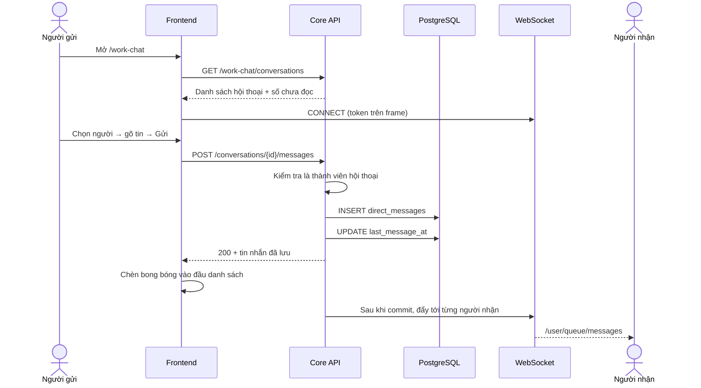
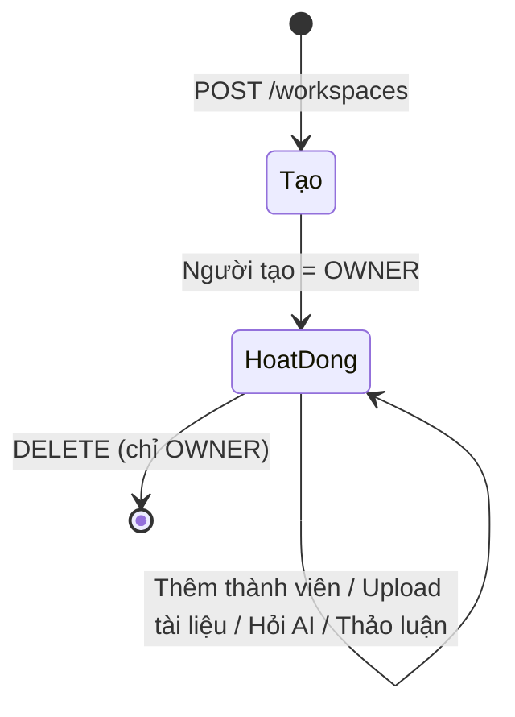
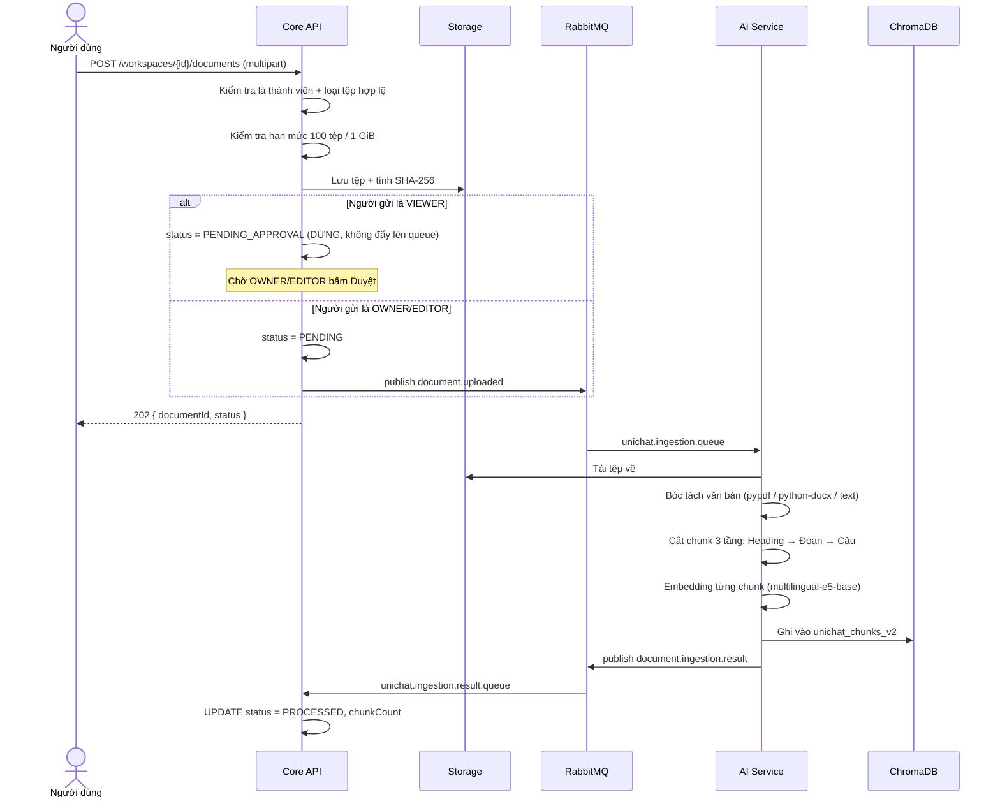

# UniChat — Luồng hoạt động: Chat cá nhân, Chat nhóm và Workspace

Tài liệu này mô tả **ba luồng nghiệp vụ chính** từ đầu đến cuối: người dùng bấm
gì, frontend gọi gì, server kiểm tra gì, dữ liệu đổi ra sao, và vì sao lại thiết
kế như vậy.

Tài liệu bổ sung cho [`kien-truc-va-luong-hoat-dong.md`](kien-truc-va-luong-hoat-dong.md)
— nơi đó là **bức tranh kiến trúc tổng thể** (cây thư mục, xác thực, ingestion,
pipeline RAG 6 bước). Nơi này đi sâu vào **ba luồng người dùng chạm vào nhiều
nhất**. Chỗ nào trùng, tài liệu này chỉ tóm tắt và dẫn link.

Mọi tham chiếu `file.java:dòng` đều trỏ tới code thật trong repo.

---

## Mục lục

- [0. Ba khái niệm phải nắm trước](#0-ba-khái-niệm-phải-nắm-trước)
- [1. Chat cá nhân (1-1)](#1-chat-cá-nhân-1-1)
- [2. Chat nhóm](#2-chat-nhóm)
- [3. Workspace](#3-workspace)
- [4. Bảng tra endpoint](#4-bảng-tra-endpoint)
- [5. Giới hạn và điểm cần biết](#5-giới-hạn-và-điểm-cần-biết)
- [6. Đọc code: mỗi file làm gì](#6-đọc-code-mỗi-file-làm-gì)

---

## 0. Ba khái niệm phải nắm trước

Ba luồng dưới đây dựa trên cùng ba nền tảng. Hiểu trước thì phần sau đọc rất
nhanh.

### 0.1 Workspace là ranh giới của mọi thứ

**Workspace** (trong giao diện gọi là "nhóm") không chỉ là nơi chứa tài liệu. Nó
là **ranh giới quyền** của toàn hệ thống:

- Bạn chỉ thấy tài liệu của workspace bạn là thành viên.
- Bạn chỉ hỏi AI được trong phạm vi tài liệu của workspace đó.
- **Bạn chỉ nhắn tin riêng được cho người cùng ít nhất một workspace với bạn.**

Điểm thứ ba là thứ nối Workspace với Chat. Không có workspace chung thì hai
người không tồn tại với nhau trong hệ thống nhắn tin.

### 0.2 Core API là nguồn quyền duy nhất

AI Service **không bao giờ** tự quyết ai được đọc gì. Core API xác định danh
sách `allowedDocumentIds` rồi mới gọi sang. Đây là nguyên tắc ghi trong
`AGENTS.md` và là lý do AI Service được giữ ở mạng nội bộ.

### 0.3 Hai đường truyền dữ liệu

| Đường | Dùng cho | Đặc điểm |
|---|---|---|
| **HTTP REST** | Mọi thao tác ghi và đọc theo yêu cầu | Có `Authorization: Bearer`, trả RFC 7807 khi lỗi |
| **WebSocket (STOMP)** | Đẩy tin nhắn tới người nhận | Một chiều server → client, xác thực lúc CONNECT |

Tin nhắn **luôn gửi bằng HTTP POST**, không gửi qua WebSocket. WebSocket chỉ để
*nhận*. Lý do: gửi qua HTTP thì có mã lỗi rõ ràng, có transaction, và tin nhắn
vẫn gửi được khi socket đang rớt.

---

## 1. Chat cá nhân (1-1)

Mã nguồn: `core-api/.../workchat/`, `frontend/src/features/work-chat/`.

### 1.1 Toàn cảnh



### 1.2 Bước 1 — Ai nhắn được cho ai

Trước khi mở được hội thoại, hệ thống phải trả lời: *người này có quyền nhắn cho
người kia không?*

Quy tắc nằm một chỗ duy nhất: `ContactDirectory.canMessage()`
(`workchat/service/ContactDirectory.java:54`).

> **Hai người nhắn được cho nhau khi và chỉ khi họ cùng là thành viên ACTIVE của
> ít nhất một workspace.**

Lý do thiết kế, ghi ngay trong chú thích của class: trong một tổ chức bất kỳ,
để ai cũng nhắn được cho người lạ là cách bị quấy rối chứ không phải tính năng.
Workspace chung là mối quan hệ mà sản phẩm vốn đã mô hình hoá.

Hai chi tiết:

- Chỉ tính thành viên **ACTIVE**. Người bị gỡ khỏi workspace sẽ mất quyền nhắn
  tin ngay, dù hội thoại cũ vẫn còn.
- **Trợ lý AI bị loại trừ** khỏi danh bạ (`ASSISTANT_USER_ID` =
  `00000000-...-a1`). Nó không phải người để nhắn riêng — muốn hỏi AI thì dùng
  Chat của workspace hoặc `@AI` trong bài thảo luận.

`GET /work-chat/contacts` trả về danh bạ, kèm **tên một workspace chung** cho
mỗi người, để phân biệt hai người trùng tên.

### 1.3 Bước 2 — Mở hội thoại

`POST /api/v1/work-chat/conversations/with/{userId}`
→ `DirectMessageService.openWith()` (`DirectMessageService.java:97`)

```
1. Người gửi == người nhận?            → 403 "Không thể nhắn tin cho chính mình"
2. canMessage(A, B) == false?          → 403 "Bạn chỉ nhắn tin được với thành viên cùng nhóm"
3. Đã có hội thoại giữa cặp này chưa?
   ├── Có  → trả về hội thoại đó
   └── Chưa → tạo mới (openPair)
```

**Chi tiết quan trọng — cặp được sắp thứ tự.** Khi tạo, hai id được sắp xếp
thành `participant_low` và `participant_high` bằng `lowerOf`/`higherOf`
(`DirectConversation.java`). Nhờ vậy cặp (A, B) và cặp (B, A) tra ra **cùng một
hàng**, nên hai người không thể vô tình tạo ra hai hội thoại song song khi cả
hai cùng bấm "Nhắn tin" một lúc. Ràng buộc `unique(participant_low,
participant_high)` ở DB chốt lại điều đó.

**Hội thoại 1-1 cũng có hàng `conversation_participants`**, y như nhóm. Việc này
cố ý: nhờ vậy *kiểm tra quyền truy cập*, *đếm chưa đọc* và *liệt kê hội thoại*
chỉ có **một** cách cài đặt dùng chung cho cả hai loại, thay vì hai nhánh code
dễ lệch nhau.

### 1.4 Bước 3 — Gửi tin nhắn

`POST /api/v1/work-chat/conversations/{id}/messages`
→ `DirectMessageService.send()` (`DirectMessageService.java:165`)

Có hai biến thể cùng đường dẫn:

| Content-Type | Dùng khi |
|---|---|
| `application/json` | Chỉ có chữ |
| `multipart/form-data` | Có tệp đính kèm (phần `body` tuỳ chọn, phần `files` lặp lại) |

Thứ tự kiểm tra trong service:

```
1. requireParticipant(người gửi, hội thoại)   → 404 nếu không tham gia
2. Độ dài chữ > 4000?                          → 400 "Tin nhắn tối đa 4000 ký tự"
3. Không có chữ VÀ không có tệp?               → 400 "Tin nhắn cần có nội dung hoặc tệp đính kèm"
4. validateAll(files)                          → 400 nếu tệp sai loại / quá nặng
5. INSERT direct_messages (id = UUIDv7)
6. Lưu từng tệp đính kèm
7. UPDATE direct_conversations.last_message_at
8. publishEvent(DirectMessageSentEvent)
```

Ba điểm thiết kế đáng chú ý:

**Tệp được kiểm tra *trước* khi tạo hàng tin nhắn** (bước 4 trước bước 5). Nếu
làm ngược lại, một tệp bị từ chối sẽ để lại một bong bóng rỗng trong hội thoại.

**Chữ và tệp đi chung một tin nhắn**, không phải "gửi tin rồi upload sau". Vì
việc đẩy tin xảy ra ngay khi commit, nếu tách ra thì người nhận sẽ thấy bong
bóng mà tệp còn đang trên đường.

**Service không biết gì về WebSocket.** Nó chỉ `publishEvent`. Việc đẩy đi là
của `WorkChatBroadcaster`. Nhờ vậy service vẫn chạy và vẫn test được mà không
cần broker.

**Trả lời 404 chứ không phải 403** khi người gọi không tham gia hội thoại
(`ConversationAccess.hidden()`). Trả 403 tức là đã xác nhận "hội thoại này có
tồn tại" cho một người lạ đoán được id.

### 1.5 Bước 4 — Người nhận nhận tin realtime

Đây là phần dễ nhầm nhất, nên đi chậm.

**Kết nối:** frontend mở STOMP tới `/ws/work-chat`
(`WebSocketConfig.java:36`). Bắt tay HTTP **không mang được header
Authorization** từ trình duyệt, nên danh tính được xác lập ở **frame CONNECT**:
`StompAuthChannelInterceptor` đọc token trên frame đó, giải mã, và đặt
`Principal` **mang tên là user id**.

**Vì sao điều đó an toàn:** Spring định tuyến mọi đích `/user/**` theo tên
principal. Nên người đăng ký `/user/queue/messages` chỉ nhận được hàng đợi của
chính họ — **không thể gọi tên hàng đợi của người khác**.

**Đẩy tin:** `WorkChatBroadcaster` lắng nghe `DirectMessageSentEvent`:

- **Chờ commit mới đẩy** (`@TransactionalEventListener`). Đẩy một tin mà
  transaction sau đó rollback sẽ hiện cho người nhận thứ không tồn tại, và không
  có sự kiện nào sau đó gỡ nó đi.
- **Đẩy tới từng người nhận một** (`convertAndSendToUser` cho mỗi id), **không**
  phát lên một topic đặt tên theo hội thoại. Lý do ghi trong chú thích:
  interceptor xác thực kết nối nhưng **không kiểm tra subscription**, nên một
  topic kiểu `/topic/conversation/{id}` sẽ bị bất kỳ ai đăng nhập đăng ký được.
- **Không gửi lại cho chính người gửi** — client của họ đã có tin từ phản hồi
  HTTP, đẩy lại sẽ nhân đôi bong bóng.

**Hai hàng đợi:**

| Đích | Nội dung | Khi nào |
|---|---|---|
| `/user/queue/messages` | Tin nhắn vừa gửi | Có tin mới |
| `/user/queue/conversations` | **Id của hội thoại vừa đổi** | Danh sách đổi mà không có tin nhắn: được thêm vào nhóm, bị xoá, nhóm đổi tên, nhóm đổi ảnh |

### 1.6 Bước 5 — Trạng thái đã đọc

`POST /api/v1/work-chat/conversations/{id}/read` → `markRead()`
(`DirectMessageService.java:210`)

Không có cờ "đã đọc" trên từng tin nhắn. Thay vào đó mỗi người có một **mốc nước
(watermark)** `last_read_at` trên hàng `conversation_participants` của mình.

Lý do: trong nhóm, "đã đọc" là sự thật của **từng người**, không phải của tin
nhắn. Một cờ trên tin nhắn sẽ phải nhân lên theo số thành viên.

Hai tính chất:

- **Idempotent** — gọi bao nhiêu lần cũng vậy.
- **Không bao giờ lùi** (`participant.readUpTo`) — cuộn lên xem lại lịch sử cũ
  không làm những tin sau đó thành chưa đọc.

Số chưa đọc trên mỗi hàng danh sách được `ConversationSummaryAssembler` tính
**một truy vấn cho cả trang**, không phải mỗi hàng một truy vấn.

### 1.7 Tệp đính kèm

`ChatAttachmentService` — giới hạn:

| Giới hạn | Giá trị |
|---|---|
| Số tệp mỗi tin nhắn | 5 |
| Tổng dung lượng mỗi tin nhắn | 20 MiB |
| Loại được phép | Ảnh (PNG/JPEG/WebP/GIF) và một danh sách tài liệu |

**Không nhận SVG và HTML** — cả hai chạy được script.

Tệp chat **cố ý không phải** tài liệu của workspace: không có `document_id`,
không vào thư viện, **không trở thành nguồn cho AI trích dẫn**. Vì vậy loại được
đặt tên `IMAGE`/`FILE` chứ không phải `IMAGE`/`DOCUMENT`, để người đọc code sau
này không tưởng nhầm là trợ lý có thể dẫn nguồn từ đó
(`V36__chat_attachments.sql`).

Tải tệp về: `GET /conversations/{cid}/messages/{mid}/attachments/{aid}/content`
— vẫn kiểm tra người gọi có tham gia hội thoại.

### 1.8 Khi mất kết nối

`use-work-chat-socket.ts`: tự kết nối lại sau **5 giây**, heartbeat **10 giây**.

Trong lúc rớt, frontend hiện dải *"Đang kết nối lại — tin nhắn vẫn gửi được."*
Câu đó đúng theo nghĩa đen: gửi đi bằng HTTP nên không phụ thuộc socket. Chỉ
việc **nhận** tin của người khác là bị chậm tới khi nối lại.

---

## 2. Chat nhóm

Nhóm dùng **chung bảng** với chat 1-1 (`direct_conversations`, cột `kind` =
`DIRECT` hoặc `GROUP`). Tên bảng vẫn mang chữ "direct" là do lịch sử: V22 dựng
cho 1-1, V37 mở rộng ra nhóm thay vì đổi tên hai bảng trên database dùng chung
(xem ADR-023).

Quản trị nhóm tách sang controller riêng: `GroupChatController`. Lý do — quản
trị một nhóm là việc khác với trò chuyện trong nó, và gộp chung đã đẩy
`WorkChatController` vượt giới hạn kích thước file.

**Đọc và gửi tin trong nhóm dùng đúng các endpoint của mục 1.** Chỉ phần quản
trị là khác.

### 2.1 Tạo nhóm

`POST /api/v1/work-chat/groups` với `{ title, memberIds[] }`

```
1. Loại trùng và loại chính mình khỏi memberIds
2. Mỗi thành viên: canMessage(người tạo, thành viên)?
   → 403 "Chỉ thêm được thành viên cùng nhóm với bạn"
3. Tổng số người > 50?  → 400 "Nhóm tối đa 50 người"
4. INSERT direct_conversations (kind=GROUP, title, created_by)
5. INSERT conversation_participants: người tạo = OWNER, còn lại = MEMBER
6. Báo cho các thành viên khác làm mới danh sách
```

**Bước 2 là cốt lõi về bảo mật.** Nếu không có nó, nhóm trở thành đường vòng để
tiếp cận người lạ: chỉ cần kéo họ vào một nhóm là nhắn được, bất chấp quy tắc
"phải cùng workspace".

### 2.2 Thành viên

| Thao tác | Endpoint | Ai được làm |
|---|---|---|
| Xem thành viên | `GET /conversations/{id}/participants` | Mọi thành viên |
| Thêm | `POST /groups/{id}/members` | **Chỉ chủ nhóm**, và người được thêm phải là contact của chủ nhóm |
| Xoá | `DELETE /groups/{id}/members/{userId}` | **Chỉ chủ nhóm**, và không tự xoá mình |
| Rời nhóm | `POST /groups/{id}/leave` | Mọi thành viên, **kể cả chủ nhóm** |

**Người mới thấy được tin nhắn cũ** từ trước khi họ vào. Đây là quyết định có
chủ đích (ADR-023): điểm của nhóm là một mạch trò chuyện chung, một thành viên
chỉ đọc được nửa sau sẽ đi trả lời những câu hỏi họ không nhìn thấy.

**Chủ nhóm rời đi thì bàn giao tự động** (`handOver`,
`GroupConversationService.java:210`): quyền chuyển cho **người tham gia sớm
nhất** trong số còn lại. Nhóm không bao giờ rơi vào trạng thái không có ai quản
trị. Đây cũng là lý do "rời nhóm" là endpoint riêng chứ không phải "tự xoá
mình".

### 2.3 Cài đặt nhóm — tên và ảnh đại diện

> **Trạng thái: đã code, chưa commit** (tính đến 2026-10-12).

| Thao tác | Endpoint | Ai được làm |
|---|---|---|
| Đổi tên | `PATCH /groups/{id}` | Chỉ chủ nhóm |
| Đặt/đổi ảnh | `PUT /groups/{id}/avatar` (multipart) | Chỉ chủ nhóm |
| Xoá ảnh | `DELETE /groups/{id}/avatar` | Chỉ chủ nhóm |
| Xem ảnh | `GET /conversations/{id}/avatar` | Mọi thành viên |

Luồng upload ảnh (`GroupAvatarService`):

```
1. requireGroupOwner(người gọi, hội thoại)
2. SquareImageEncoder.encode(file, "Ảnh nhóm")
   ├── Rỗng / > 2 MiB / sai loại  → 400
   ├── Giải mã ảnh (đây mới là phép kiểm tra thật — content-type chỉ là lời khai của client)
   └── Cắt vuông giữa, vẽ lại thành PNG 256×256
3. Lưu vào object store với khoá group-avatars/{conversationId}/{uuid}.png
4. UPDATE direct_conversations.avatar_storage_key
5. Báo các thành viên khác làm mới danh sách
6. Xoá blob cũ (thất bại ở bước này chỉ ghi log, không làm hỏng ảnh vừa lưu)
```

**Ảnh không bao giờ được lưu nguyên trạng.** Nó được giải mã rồi vẽ lại. Việc
này vừa chặn trần chi phí phục vụ một file khổng lồ, vừa **loại bỏ toàn bộ
metadata** — một tấm ảnh chụp bằng điện thoại nếu không xử lý sẽ gửi kèm **toạ
độ GPS** cho mọi người trong nhóm.

Phần giải mã-vẽ lại này dùng chung với ảnh đại diện người dùng
(`SquareImageEncoder`), **không chép lại**. Nếu để hai bản sao, ngày nào sửa một
bên thì bên kia vẫn lặng lẽ giữ nguyên EXIF.

### 2.4 Gửi và nhận trong nhóm

Giống hệt 1-1, chỉ khác bước fan-out: `recipientsOf()` trả về **mọi thành viên
trừ người gửi**, và broadcaster đẩy tới **từng người một**.

### 2.5 So sánh nhanh

| | Chat 1-1 | Chat nhóm |
|---|---|---|
| `kind` | `DIRECT` | `GROUP` |
| `participant_low/high` | Cặp đã sắp thứ tự | `NULL` |
| `title` | `NULL` (hiện tên người kia) | Tên nhóm |
| Thành viên | Luôn 2 | 2–50 |
| Vai trò | Không có | `OWNER` / `MEMBER` |
| Ảnh đại diện | Ảnh của người đối diện | Ảnh riêng của nhóm, hoặc ghép mặt thành viên |
| Tạo thế nào | Tự động khi nhắn lần đầu | Người dùng chủ động tạo |
| Ai vào được | Cố định | Chủ nhóm thêm/xoá |

---

## 3. Workspace

Mã nguồn: `core-api/.../workspace/`, `frontend/src/features/workspaces/`.

### 3.1 Vòng đời



### 3.2 Ba vai trò

| | OWNER | EDITOR | VIEWER |
|---|:---:|:---:|:---:|
| Xem tài liệu, hỏi AI | ✅ | ✅ | ✅ |
| Đọc và viết bài thảo luận | ✅ | ✅ | ✅ |
| Upload tài liệu | ✅ | ✅ | Gửi đóng góp, **chờ duyệt** |
| Duyệt / từ chối đóng góp | ✅ | ✅ | ❌ |
| Sửa tên, mô tả workspace | ✅ | ✅ | ❌ |
| Đổi chế độ hiển thị | ✅ | ❌ | ❌ |
| Quản lý thành viên | ✅ | ❌ | ❌ |
| Xoá workspace | ✅ | ❌ | ❌ |
| Đăng thông báo (ANNOUNCEMENT) | ✅ | ✅ | ❌ |

Hai ràng buộc cứng trong `WorkspaceMemberService`:

- **Không đổi được vai trò của chủ sở hữu chính** (`:105`).
- **Không xoá được chủ sở hữu khỏi workspace** (`:131`).

Nếu thiếu hai ràng buộc này, một workspace có thể rơi vào trạng thái không ai
quản trị được nữa.

### 3.3 Tạo và tham gia

**Tạo:** `POST /api/v1/workspaces` → tạo workspace + hàng thành viên đầu tiên
với vai trò OWNER, trong cùng một transaction.

**Chế độ hiển thị:** `PRIVATE` (chỉ người được mời) hoặc `PUBLIC` (ai cũng tìm
thấy và tự tham gia).

Hai cách để vào một workspace:

| Cách | Endpoint | Vai trò nhận được |
|---|---|---|
| Được OWNER thêm | `POST /workspaces/{id}/members` | OWNER chọn |
| Tự tham gia workspace công khai | `POST /workspaces/{id}/join` | **Luôn là VIEWER** |

Tự tham gia luôn vào vai VIEWER — người lạ tự bước vào không thể lập tức có
quyền ghi. Nếu workspace là `PRIVATE` thì trả 403 "Chỉ có thể tham gia workspace
công khai".

Tab **Khám phá** (`GET /workspaces/explore`) chỉ liệt kê workspace công khai mà
người dùng **chưa** tham gia.

### 3.4 Tài liệu — từ upload đến khi AI trích dẫn được

Đây là luồng duy nhất đi qua RabbitMQ, vì bóc tách và embedding mất hàng chục
giây — không thể bắt người dùng chờ trong một request HTTP.



**Các trạng thái tài liệu** (`DocumentStatus.java`):

| Trạng thái | Nghĩa | AI dùng được chưa? |
|---|---|---|
| `PENDING_APPROVAL` | VIEWER đóng góp, chờ duyệt | ❌ |
| `REJECTED` | Bị từ chối | ❌ |
| `PENDING` | Đã nhận, chờ xử lý | ❌ |
| `PROCESSING` | Đang bóc tách / embedding | ❌ |
| `PROCESSED` | Xong, đã có vector | ✅ |
| `FAILED` | Xử lý lỗi | ❌ |
| `DELETING` | Đang xoá | ❌ |

Ba điểm cần biết:

- **Đóng góp của VIEWER không bao giờ được đẩy lên queue** trước khi có người
  duyệt. Đây là chốt chặn để một thành viên quyền thấp không tự đưa nội dung vào
  nguồn tri thức mà trợ lý sẽ trích dẫn.
- **Publish thất bại không làm hỏng upload.** Exception chỉ được ghi log, tài
  liệu nằm lại ở `PENDING` để thử lại sau.
- **Hạn mức kiểm tra trước khi ghi**: 100 tài liệu và 1 GiB mỗi workspace.

### 3.5 Hỏi đáp RAG

Đây là **P0 của sản phẩm**. Pipeline 6 bước được mô tả đầy đủ ở
[`kien-truc-va-luong-hoat-dong.md` §4.3](kien-truc-va-luong-hoat-dong.md).
Tóm tắt phần liên quan tới quyền:

```
1. Core API nhận câu hỏi, xác thực người dùng là thành viên workspace
2. Core API tự xác định danh sách allowedDocumentIds (chỉ tài liệu PROCESSED
   của workspace đó)
3. Core API gọi AI Service, GỬI KÈM danh sách đó
4. AI Service truy hồi trong phạm vi được cho, sinh câu trả lời kèm trích dẫn
5. Core API KIỂM TRA LẠI quyền trên các trích dẫn trước khi trả về client
```

Bước 5 không thừa. `AGENTS.md` yêu cầu *"xác minh quyền trên mọi endpoint và
xác minh lại trước khi lưu/trả về sau khi gọi AI"* — AI Service không được phép
trở thành nguồn quyền thứ hai.

### 3.6 Cộng đồng trong workspace

Mỗi workspace có bảng tin riêng: `QUESTION` (câu hỏi), `DISCUSSION` (thảo luận),
`ANNOUNCEMENT` (thông báo — chỉ OWNER/EDITOR đăng được).

- Chỉ **câu hỏi** mới có trạng thái lời giải (*Chưa có lời giải / Đang thảo luận
  / Đã giải đáp*). Thảo luận và thông báo không có gì để chờ giải đáp.
- **Chỉ tác giả** mới chấp nhận hoặc gỡ lời giải — chỉ người hỏi mới biết vấn đề
  của mình đã xong hay chưa.
- Nhắc `@AI` trong bình luận sẽ gọi trợ lý trả lời ngay trong mạch thảo luận, có
  trích dẫn.

### 3.7 Ảnh bìa workspace

> **Trạng thái: đã code, chưa commit** (tính đến 2026-10-12).

- Workspace **đã upload ảnh riêng** → hiện ảnh đó (`GET /workspaces/{id}/cover`,
  tải dạng blob vì cần bearer token).
- Workspace **chưa upload** → nhận một trong **20 ảnh mặc định** đóng gói sẵn
  tại `frontend/public/covers/`.

Phép gán đảm bảo **không hai workspace nào trên cùng một trang đội cùng một
ảnh**. Băm riêng từng id không làm được điều đó dù có bao nhiêu ảnh: 10
workspace với 20 ảnh vẫn trùng với xác suất trên 9/10 (nghịch lý ngày sinh), và
thực tế đã trùng. Nên phép gán nhìn cả danh sách, mỗi workspace lấy ảnh mình băm
ra hoặc ảnh trống kế tiếp.

Ô vuông chữ cái ở dải điều hướng trái lấy **màu trích từ chính ảnh bìa** đó, nên
nó hoạt động như chú giải: quét dải trái tìm nhóm màu tím là ra đúng nhóm có thẻ
màu tím.

---

## 4. Bảng tra endpoint

Tiền tố chung: `/api/v1`.

### Chat (cá nhân và nhóm dùng chung)

| Method | Đường dẫn | Quyền |
|---|---|---|
| GET | `/work-chat/contacts` | Đăng nhập |
| GET | `/work-chat/presence` | Đăng nhập — chỉ hiện contact đang online |
| GET | `/work-chat/conversations` | Thành viên — phân trang, mặc định 20 |
| POST | `/work-chat/conversations/with/{userId}` | Phải cùng workspace |
| GET | `/work-chat/conversations/{id}/messages` | Thành viên hội thoại — mới nhất trước |
| POST | `/work-chat/conversations/{id}/messages` | Thành viên hội thoại |
| GET | `/work-chat/conversations/{cid}/messages/{mid}/attachments/{aid}/content` | Thành viên hội thoại |
| POST | `/work-chat/conversations/{id}/read` | Thành viên hội thoại |
| GET | `/work-chat/conversations/{id}/participants` | Thành viên hội thoại |

### Quản trị nhóm

| Method | Đường dẫn | Quyền |
|---|---|---|
| POST | `/work-chat/groups` | Đăng nhập |
| PATCH | `/work-chat/groups/{id}` | Chủ nhóm |
| POST | `/work-chat/groups/{id}/members` | Chủ nhóm |
| DELETE | `/work-chat/groups/{id}/members/{userId}` | Chủ nhóm |
| POST | `/work-chat/groups/{id}/leave` | Thành viên |
| PUT | `/work-chat/groups/{id}/avatar` | Chủ nhóm |
| DELETE | `/work-chat/groups/{id}/avatar` | Chủ nhóm |
| GET | `/work-chat/conversations/{id}/avatar` | Thành viên |

### Workspace

| Method | Đường dẫn | Quyền |
|---|---|---|
| GET | `/workspaces` | Đăng nhập — workspace của tôi |
| POST | `/workspaces` | Đăng nhập — người tạo thành OWNER |
| GET | `/workspaces/explore` | Đăng nhập — công khai và chưa tham gia |
| GET | `/workspaces/{id}` | Thành viên |
| PATCH | `/workspaces/{id}` | OWNER / EDITOR (đổi hiển thị: chỉ OWNER) |
| DELETE | `/workspaces/{id}` | Chỉ OWNER |
| POST | `/workspaces/{id}/join` | Workspace công khai → vào làm VIEWER |
| GET/POST/PATCH/DELETE | `/workspaces/{id}/members[/{userId}]` | Xem: thành viên. Sửa: chỉ OWNER |
| PUT/DELETE/GET | `/workspaces/{id}/cover` | Sửa: OWNER/EDITOR. Xem: thành viên |

### WebSocket

| Đích | Chiều | Nội dung |
|---|---|---|
| `/ws/work-chat` | Bắt tay | Token đi trên frame CONNECT |
| `/user/queue/messages` | Server → client | Tin nhắn mới |
| `/user/queue/conversations` | Server → client | Id hội thoại vừa thay đổi |

---

## 5. Giới hạn và điểm cần biết

### Con số

| Hạng mục | Giới hạn |
|---|---|
| Độ dài tin nhắn | 4 000 ký tự |
| Tệp mỗi tin nhắn | 5 tệp, tổng 20 MiB |
| Thành viên mỗi nhóm chat | 50 |
| Ảnh đại diện nhóm | 2 MiB, PNG/JPEG/WebP, lưu thành PNG 256×256 |
| Ảnh bìa workspace | 5 MiB, lưu thành JPEG 1200×400 |
| Tài liệu mỗi workspace | 100 tệp, tổng 1 GiB |
| Phân trang | Mặc định 20, tối đa 100 |
| Access token | RS256, 15 phút |
| Kết nối lại WebSocket | 5 giây |

### Những chỗ đã cân nhắc và cố ý làm vậy

- **Tên bảng `direct_*` giữ nguyên dù đã chứa cả nhóm.** Đổi tên hai bảng trên
  database dùng chung đổi được một cái tên đẹp hơn, nhưng cái giá là mọi nhánh
  đang checkout đều hỏng (ADR-023).
- **Tệp chat không phải tài liệu workspace.** Chúng không vào thư viện, không
  thành nguồn trích dẫn của AI.
- **Trả 404 thay vì 403** cho hội thoại không thuộc về người gọi.
- **Mốc nước đã đọc thay vì cờ trên từng tin nhắn.**
- **Ảnh luôn được vẽ lại, không lưu nguyên trạng** — để loại metadata EXIF.

### Hạn chế hiện tại

- **WebSocket dùng simple broker trong bộ nhớ** (`enableSimpleBroker`). Chạy
  nhiều instance Core API thì client nối vào instance A sẽ không nhận được tin
  do instance B đẩy. Muốn scale ngang phải chuyển sang broker ngoài.
- **Trạng thái online đếm theo session trong bộ nhớ** (`PresenceTracker`), nên
  có cùng hạn chế trên.
- **Chưa có E2E Playwright cho luồng chat nhóm** — mới có unit test và test
  tích hợp.
- **Ô màu ở dải trái lấy từ ảnh bìa mặc định**, nên workspace nào **đã tự upload
  ảnh riêng** thì màu ô không liên quan tới thẻ của họ. Chỗ này đang là khoảng
  trống đã biết.

---

## 6. Đọc code: mỗi file làm gì

Phần này dành cho người **mới vào dự án**. Mục tiêu: mở thư mục `workchat/` hay
`workspace/` ra là biết nên đọc file nào, và sửa gì thì vào đâu.

### 6.1 Ba lớp: `api` → `service` → `domain`

Mỗi tính năng trong `core-api` đều chia làm ba thư mục. Hãy hình dung một nhà
hàng:

| Thư mục | Vai trò | Ví von |
|---|---|---|
| `api/` | Nhận yêu cầu HTTP, trả kết quả | **Người phục vụ** — ghi order, bưng món ra. Không nấu. |
| `service/` | Quy tắc nghiệp vụ: ai được làm gì, hợp lệ hay không | **Đầu bếp** — biết công thức, biết món nào không phục vụ cho ai. |
| `domain/` | Hình dạng dữ liệu và cách đọc/ghi database | **Kho và sổ sách** — nguyên liệu nằm đâu, lấy ra bằng cách nào. |

**Luật quan trọng nhất: phụ thuộc chỉ đi một chiều.**

```
api  ──gọi──>  service  ──gọi──>  domain

domain KHÔNG BAO GIỜ gọi ngược lên service hay api
```

Vì sao phải vậy? Hai lợi ích rất thực tế:

- **Đổi giao diện không phải sửa quy tắc.** Mai mốt làm app mobile gọi cùng API,
  `service/` không phải đụng một dòng.
- **Test được quy tắc mà không cần chạy server.** Toàn bộ 346 test của core-api
  chạy trong vài chục giây chính vì `service/` không dính Tomcat hay database
  thật.

Riêng Work Chat có thêm thư mục thứ tư là **`ws/`** (WebSocket) — phần đẩy tin
nhắn realtime. Nó tách riêng vì không phải REST.

### 6.2 Nhìn tên file là đoán được việc

Dự án đặt tên theo quy ước. Thuộc bảng này là đọc code nhanh hơn hẳn:

| Đuôi tên | Nó là gì | Ví dụ |
|---|---|---|
| `...Controller` | Khai báo các đường dẫn HTTP. Rất mỏng, chỉ nhận và chuyển tiếp. | `WorkChatController` |
| `...Request` | Dữ liệu client **gửi lên**. Có annotation kiểm tra hợp lệ. | `CreateGroupRequest` |
| `...Response` / `...Summary` | Dữ liệu server **trả về**. Cố ý *không* bằng với entity. | `MessageResponse` |
| `...Service` | Nơi chứa quy tắc nghiệp vụ. **Đọc file này trước khi đọc controller.** | `DirectMessageService` |
| `...Repository` | Giao tiếp database. Là `interface`, Spring tự sinh phần cài đặt. | `DirectMessageRepository` |
| *(không đuôi, trong `domain/`)* | **Entity** — ánh xạ 1-1 với một bảng trong database. | `DirectMessage` |
| `...Id` | Khoá chính gồm nhiều cột. | `ConversationParticipantId` |
| `...Event` | Thông báo "việc X vừa xảy ra" cho phần khác xử lý. | `DirectMessageSentEvent` |
| `enum` | Danh sách giá trị cố định. | `ParticipantRole` |

**Vì sao `Response` không dùng thẳng entity?** Vì entity chứa thứ không được lộ
ra ngoài. Ví dụ `ChatAttachment` có `storage_key` — đường dẫn tới file trong kho.
`ChatAttachmentResponse` cố ý **bỏ trường đó đi**, vì byte của file phải đi qua
endpoint có kiểm tra quyền, chứ không để client tự mò tới kho.

### 6.3 Thư mục `workchat/` — từng file

#### `workchat/api/` — cửa ngõ HTTP

| File | Việc của nó |
|---|---|
| `WorkChatController` | Mọi đường dẫn để **trò chuyện**: danh bạ, danh sách hội thoại, đọc/gửi tin, tải tệp, đánh dấu đã đọc. |
| `GroupChatController` | Mọi đường dẫn để **quản trị nhóm**: tạo, đổi tên, thêm/xoá thành viên, rời nhóm, ảnh nhóm. Tách khỏi file trên vì quản trị nhóm là việc khác với trò chuyện, và gộp chung đã làm file vượt giới hạn 300 dòng. |
| `SendMessageRequest` | Nội dung tin nhắn gửi lên. Chuỗi rỗng bị từ chối thay vì lưu một hàng trống. |
| `CreateGroupRequest` | Tên nhóm + danh sách thành viên. **Không chứa người tạo** — họ là chủ nhóm nhờ việc tạo ra nó. |
| `AddMemberRequest` | Id người được thêm vào nhóm. |
| `RenameGroupRequest` | Tên mới của nhóm. |
| `ContactSummary` | Một người trong danh bạ, kèm tên **một nhóm chung** — chính cái nhóm đó là thứ cho phép nhắn tin. |
| `ConversationSummary` | Một dòng trong danh sách hội thoại: tiêu đề, tin cuối, số chưa đọc, thành viên. |
| `MessageResponse` | Một tin nhắn trả về client. **Không mang trạng thái đã đọc** — trong nhóm đó là sự thật của từng người, không phải của tin nhắn. |
| `ParticipantSummary` | Một thành viên trong hội thoại, kèm vai trò và cờ `me` để giao diện biết dòng nào là chính mình. |
| `ChatAttachmentResponse` | Thông tin một tệp đính kèm. **Cố ý giấu `storage_key`.** |

#### `workchat/domain/` — dữ liệu

| File | Việc của nó |
|---|---|
| `DirectConversation` | **Entity bảng `direct_conversations`.** Một hội thoại, 1-1 hoặc nhóm. File dài nhất trong `domain/` vì chứa luật tạo đúng hình dạng từng loại. |
| `DirectMessage` | Entity một tin nhắn. Chữ **có thể null** vì tin nhắn có thể chỉ có tệp. |
| `ConversationParticipant` | Entity "ai đang ở trong hội thoại nào", kèm vai trò và mốc đã đọc. Có cho **cả** 1-1 lẫn nhóm. |
| `ConversationParticipantId` | Khoá chính ghép: một hàng cho mỗi cặp (hội thoại, người). |
| `ChatAttachment` | Entity một tệp đính kèm. Thuộc về **tin nhắn**, không thuộc hội thoại — để tệp và chữ đi cùng nhau như một thứ. |
| `ConversationKind` | `DIRECT` hoặc `GROUP`. |
| `ParticipantRole` | `OWNER` hoặc `MEMBER`. Ai cũng đọc/viết được; chỉ OWNER đổi được **chính cái nhóm**. |
| `ChatAttachmentKind` | `IMAGE` hoặc `FILE`. **Cố ý không đặt tên `DOCUMENT`** để không ai tưởng nhầm tệp chat là nguồn AI trích dẫn được. |
| `DirectMessageSentEvent` | "Vừa lưu xong một tin nhắn." Để phần đẩy WebSocket tách khỏi phần lưu tin. |
| `ConversationListChangedEvent` | "Danh sách hội thoại của những người này vừa đổi" — khi không có tin nhắn nào nhưng danh sách vẫn phải làm mới. |
| `*Repository` (4 file) | Câu truy vấn database. Là `interface` — Spring Data tự sinh phần cài đặt. |

> **Mẹo cho người mới:** `findByConversationIdOrderByCreatedAtDesc` không có thân
> hàm, mà vẫn chạy. Spring Data đọc **tên phương thức** rồi tự sinh câu SQL. Khi
> cần câu phức tạp hơn thì viết `@Query` tường minh.

#### `workchat/service/` — quy tắc nghiệp vụ

Đây là nơi đáng đọc nhất. Mỗi file giữ **một** trách nhiệm:

| File | Câu hỏi nó trả lời |
|---|---|
| `ContactDirectory` | *"Tôi được nhắn cho ai?"* → Người cùng ít nhất một workspace. |
| `ConversationAccess` | *"Người này có được xem hội thoại này không? Có phải chủ nhóm không?"* Mọi nơi khác đều hỏi qua đây, để luật chỉ có **một** chỗ. |
| `DirectMessageService` | Mở hội thoại, gửi tin, đọc tin, đánh dấu đã đọc. |
| `GroupConversationService` | Tạo nhóm, thêm/xoá thành viên, rời nhóm, bàn giao chủ nhóm. |
| `GroupAvatarService` | Ảnh đại diện nhóm. |
| `ChatAttachmentService` | Kiểm tra và lưu tệp đính kèm. |
| `ConversationSummaryAssembler` | Gom dữ liệu từ 4 nguồn thành các dòng danh sách, **mỗi trang một truy vấn** thay vì mỗi dòng một truy vấn. |

> **Vì sao tách nhiều service nhỏ thay vì một service to?** Hai lý do. Một là
> giới hạn 300 dòng mỗi file của dự án. Hai, quan trọng hơn: luật "ai được xem
> hội thoại" nếu viết ở hai chỗ thì **hai chỗ đó sẽ mâu thuẫn nhau** — việc này
> đã thực sự xảy ra trong dự án và gây ra lỗi.

#### `workchat/ws/` — WebSocket

| File | Việc của nó |
|---|---|
| `WebSocketConfig` | Khai báo địa chỉ `/ws/work-chat` và các hàng đợi. |
| `StompAuthChannelInterceptor` | **Xác thực.** Bắt tay HTTP không mang được token, nên danh tính lấy từ frame CONNECT. |
| `WorkChatBroadcaster` | Đẩy tin tới từng người nhận, **chỉ sau khi transaction commit**. |
| `PresenceTracker` | Đếm ai đang online. Lưu trong RAM của tiến trình. |

### 6.4 Thư mục `workspace/` — từng file

#### `workspace/api/`

| File | Việc của nó |
|---|---|
| `WorkspaceController` | Tạo / xem / sửa / xoá workspace, khám phá workspace công khai, tham gia, ảnh bìa. |
| `WorkspaceMemberController` | Xem và quản lý thành viên, đổi vai trò. |
| `CreateWorkspaceRequest` | Dữ liệu tạo workspace mới. |
| `UpdateWorkspaceRequest` | Dữ liệu sửa workspace. |
| `AddWorkspaceMemberRequest` | Thêm thành viên. |
| `UpdateWorkspaceMemberRequest` | Đổi vai trò một thành viên. |
| `WorkspaceResponse` | Workspace trả về client, kèm số liệu tổng hợp **và vai trò của chính người đang gọi**. |
| `WorkspaceMemberResponse` | Thông tin một thành viên. |
| `WorkspaceCardStats` | Những gì thẻ workspace hiện ngoài cái tên: mặt thành viên, hoạt động gần đây. Trước đây thẻ chỉ có con số nên **mọi thẻ trông như nhau**. |

#### `workspace/domain/`

| File | Việc của nó |
|---|---|
| `Workspace` | Entity bảng `workspaces` — ranh giới chứa tài liệu, hội thoại và quyền. |
| `WorkspaceMember` | Entity "người X là thành viên workspace Y với vai trò Z". |
| `WorkspaceMemberId` | Khoá chính ghép (workspace, user). |
| `WorkspaceRole` | `OWNER` / `EDITOR` / `VIEWER`. |
| `WorkspaceVisibility` | `PRIVATE` / `PUBLIC`. |
| `WorkspaceStatus` | Trạng thái workspace trong hệ thống. |
| `WorkspaceMemberStatus` | `ACTIVE` và các trạng thái khác. **Quan trọng:** người bị gỡ vẫn còn hàng dữ liệu nhưng không còn ACTIVE — nên mọi truy vấn quyền đều phải lọc theo trạng thái này. |
| `WorkspaceRepository` | Truy vấn workspace. |
| `WorkspaceMemberRepository` | Truy vấn thành viên — file repository dài nhất, vì gần như mọi kiểm tra quyền đều đi qua đây. |

#### `workspace/service/`

| File | Việc của nó |
|---|---|
| `WorkspaceService` | Vòng đời workspace: tạo, sửa, xoá, khám phá, tự tham gia. **Và kiểm tra quyền cho từng thao tác.** |
| `WorkspaceMemberService` | Thêm/xoá thành viên, đổi vai trò. Chứa hai chốt chặn: không đổi vai trò chủ sở hữu chính, không xoá chủ sở hữu. |
| `WorkspaceCoverService` | Ảnh bìa: giải mã, cắt theo tỉ lệ thẻ, mã hoá lại thành JPEG. |
| `WorkspaceStatsLoader` | Gom số liệu cho **cả một trang thẻ trong 4 truy vấn**. Trước đây mỗi workspace một truy vấn đếm thành viên, nên liệt kê 20 nhóm là 20 lần gọi database. |

> **Khái niệm "N+1 query" cho người mới:** hiển thị 20 thẻ mà mỗi thẻ tự đi đếm
> thành viên của mình thì tốn 1 + 20 = 21 lần gọi database. `WorkspaceStatsLoader`
> và `ConversationSummaryAssembler` sinh ra chính để tránh điều đó: gom tất cả
> vào vài truy vấn cho cả trang. Đây là lỗi hiệu năng phổ biến nhất khi mới làm
> web.

### 6.5 Muốn sửa X thì mở file nào

| Tôi muốn... | Mở file |
|---|---|
| Đổi giới hạn 4000 ký tự mỗi tin nhắn | `workchat/service/DirectMessageService.java` |
| Đổi giới hạn 50 người mỗi nhóm | `workchat/service/GroupConversationService.java` |
| Cho phép thêm định dạng tệp đính kèm | `workchat/service/ChatAttachmentService.java` |
| Đổi luật "ai nhắn được cho ai" | `workchat/service/ContactDirectory.java` |
| Thêm một endpoint chat mới | `workchat/api/WorkChatController.java` + service tương ứng |
| Thêm một cột vào bảng hội thoại | `workchat/domain/DirectConversation.java` **và** một file migration mới trong `db/migration/` |
| Đổi quyền của vai trò EDITOR | `workspace/service/WorkspaceService.java` |
| Thêm thông tin lên thẻ workspace | `workspace/api/WorkspaceCardStats.java` + `workspace/service/WorkspaceStatsLoader.java` |
| Đổi kích thước ảnh bìa | `workspace/service/WorkspaceCoverService.java` |

> **Luật bất di bất dịch:** thêm hoặc sửa cột trong database thì **phải** có file
> migration mới trong `core-api/src/main/resources/db/migration/`. Sửa entity mà
> quên migration thì ứng dụng không khởi động được — Hibernate sẽ báo
> `missing column`. Và **không bao giờ sửa file migration đã chạy**, luôn tạo
> file mới với số lớn hơn.

### 6.6 Lần theo một request từ đầu đến cuối

Ví dụ cụ thể: **An gửi tin nhắn "chào" cho Bình**. Request đi qua đúng những file
này, theo thứ tự:

```
1. WorkChatController.send()                 api/      Nhận HTTP POST, lấy userId từ token
       |
2. DirectMessageService.send()               service/  Bắt đầu transaction
       |
3. ConversationAccess.requireParticipant()   service/  An có trong hội thoại này không?
       |                                               Không -> ném lỗi, dừng tại đây
4. Kiểm tra độ dài chữ, kiểm tra tệp         service/
       |
5. DirectMessageRepository.save()            domain/   INSERT vào direct_messages
       |
6. DirectConversationRepository.save()       domain/   Cập nhật last_message_at
       |
7. publishEvent(DirectMessageSentEvent)      service/  Bắn sự kiện rồi đi tiếp ngay
       |
8. [ TRANSACTION COMMIT ]
       |
9. WorkChatBroadcaster.onMessageSent()       ws/       Chỉ chạy SAU khi commit
       |
10. Bình nhận tin qua /user/queue/messages
```

Ba điều một người mới nên rút ra từ sơ đồ này:

1. **Controller rất mỏng.** Nó chỉ lấy `userId` từ token rồi gọi service. Mọi
   quyết định nằm ở service.
2. **Kiểm tra quyền xảy ra sớm nhất có thể** (bước 3), trước khi làm bất cứ việc
   gì tốn kém.
3. **Việc đẩy tin nằm ngoài transaction** (bước 9 sau bước 8). Nếu đẩy trước khi
   commit mà transaction sau đó rollback, Bình sẽ nhìn thấy một tin nhắn **không
   tồn tại**, và không có sự kiện nào sau đó gỡ nó đi.

### 6.7 Muốn đọc code từng dòng

Tài liệu này nói **file nào làm việc gì**. Nếu bạn muốn đi sâu hơn — trích đúng
đoạn code và giải thích từng dòng, từng ký hiệu `@`, từng cú pháp Java — thì đọc
[`doc-code-cho-nguoi-moi.md`](doc-code-cho-nguoi-moi.md). Nó đi theo đúng một
request từ lúc bấm Gửi tới lúc người nhận thấy tin nhắn, dừng ở 7 chặng.

### 6.8 Nên đọc theo thứ tự nào

Nếu bạn mới nhận dự án, đọc theo đúng thứ tự này sẽ đỡ rối nhất:

1. `workspace/domain/WorkspaceRole.java` và `WorkspaceMember.java` — hiểu ai là ai.
2. `workchat/service/ContactDirectory.java` — luật nền tảng nhất, chỉ 102 dòng.
3. `workchat/domain/DirectConversation.java` — hiểu một hội thoại có hình dạng gì.
4. `workchat/service/DirectMessageService.java` — luồng chính.
5. `workchat/ws/WorkChatBroadcaster.java` — hiểu phần realtime.
6. `workspace/service/WorkspaceService.java` — vòng đời workspace và kiểm tra quyền.

**Đọc javadoc trước khi đọc code.** Trong dự án này javadoc không mô tả lại code
làm gì — nó giải thích **vì sao lại làm như vậy**, và thường nhắc tới cách làm đã
thử rồi hỏng. Đó là thứ không đọc được từ bản thân dòng code.

---

## Đọc tiếp

| Cần gì | Đọc đâu |
|---|---|
| Kiến trúc tổng thể, cây thư mục, pipeline RAG | [`kien-truc-va-luong-hoat-dong.md`](kien-truc-va-luong-hoat-dong.md) |
| Hợp đồng API đầy đủ | [`specifications/api-contracts.md`](specifications/api-contracts.md) |
| Bảng và quan hệ dữ liệu | [`specifications/data-model.md`](specifications/data-model.md) |
| Quyết định kiến trúc | [`specifications/architecture-decision.md`](specifications/architecture-decision.md) |
| Chiến lược kiểm thử | [`specifications/test-plan.md`](specifications/test-plan.md) |
| Nhật ký quyết định khi phát triển | [`../.pipeline/decisions-log.md`](../.pipeline/decisions-log.md) |
